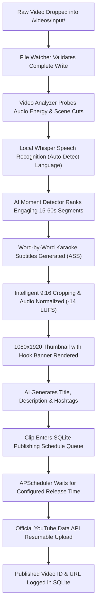

# AutoTube AI — Fully Automated YouTube Shorts Studio

> **Autonomous AI Video Clipping, Karaoke Subtitles & Scheduled YouTube Upload System**  
> *Zero Recurring Investment • No Paid APIs • 100% Free & Open-Source Stack*

---

## 🌟 Overview

**AutoTube AI** is a production-ready desktop automation suite that transforms long-form horizontal videos into viral, high-retention 9:16 vertical YouTube Shorts without human intervention.

Once configured, simply drop video files into the input folder. AutoTube AI continuously monitors, transcribes, identifies high-engagement moments, crops to 1080x1920, burns word-by-word karaoke subtitles, designs eye-catching thumbnails, generates SEO metadata, queues releases into daily time slots, and uploads directly to YouTube via the official YouTube Data API v3.

---

## 🚀 Key Features

- **Autonomous Folder Ingestion**: Watches `videos/input/` for new `.mp4`, `.mov`, `.mkv`, and `.webm` files. Validates file write completion and prevents duplicate processing.
- **Local Speech-to-Text (faster-whisper)**: 100% offline speech recognition running on ordinary CPUs. Auto-detects spoken language and produces millisecond word timestamps.
- **Multimodal AI Moment Detection**:
  - Sentence-boundary clustering (never cuts sentences in half).
  - Hook trigger and question detection (rewards strong opening sentences).
  - Audio loudness & enthusiasm peak analysis.
  - Scene transition detection (preserves visual context).
  - Configurable clip duration (15s to 60s, default 35s).
- **Intelligent 9:16 Vertical Video Engine**:
  - `smart` mode: Detects speaker focal center and smoothly centers subjects horizontally.
  - `blur_fill` mode: High-end Shorts format with zoomed, blurred background mirror.
  - `crop` mode: 9:16 center crop.
  - Encodes pristine 1080x1920 H.264 MP4 videos at 30 FPS.
- **Word-by-Word Karaoke Subtitles**:
  - Displays readable 3–4 word phrase bursts in the lower-third.
  - Highlights active spoken words in real time with vibrant gold/yellow styling and thick black outlines.
- **Audio Normalization & Background Music**:
  - Normalizes speech audio to broadcast standards (-14 LUFS).
  - Optional royalty-free music mixing from `videos/background_music/` with automatic speech ducking.
- **High-Converting 9:16 Thumbnails**:
  - Selects the sharpest, most expressive video frame.
  - Adds dark top/bottom vignette gradients for guaranteed readability.
  - Renders red branding badges and yellow hook text banners.
- **AI Metadata Generator**:
  - Catchy, compliant YouTube Shorts titles (< 60 chars) with `#Shorts`.
  - SEO-rich descriptions, hashtags, and searchable keyword tags.
  - Auto-selects appropriate YouTube Category IDs (Entertainment, Science & Tech, Gaming, Education, etc.).
- **Official YouTube Data API v3 & Google OAuth 2.0**:
  - Chunked resumable uploads with exponential backoff retry.
  - Automatic token refresh via `token.json`.
  - Enforces quota limits and YouTube platform policies safely.
- **Publishing Queue & Timetable Scheduler**:
  - Configurable daily release slots (e.g., 09:00 AM, 12:00 PM, 03:00 PM, 06:00 PM, 09:00 PM in `Asia/Kolkata` timezone).
  - Prevents simultaneous publishing collisions.
  - Automatically recovers and resumes after computer reboots.
- **Glassmorphism Streamlit Dashboard**:
  - 10 comprehensive management views: Studio Overview, Source Videos, AI Clipping, Processed Clips, Upload Queue, Publishing Calendar, YouTube Settings, Automation Settings, Upload History, and Error Logs.
  - Live Start, Pause, and Stop engine controls.

---

## 🛠 Technology Stack & Zero-Cost Architecture

| Component | Technology | Cost |
| :--- | :--- | :--- |
| **Language** | Python 3.11+ | Free / Open Source |
| **Video Engine** | FFmpeg & ffprobe | Free / Open Source |
| **Visual Analysis** | OpenCV (cv2) & Pillow | Free / Open Source |
| **Speech-to-Text** | faster-whisper (CTranslate2) | Free / Open Source |
| **Database** | SQLite3 (WAL mode) | Free / Serverless |
| **Scheduler** | APScheduler | Free / Open Source |
| **File Watcher** | Watchdog | Free / Open Source |
| **Web Dashboard** | Streamlit | Free / Open Source |
| **YouTube Publishing** | Google OAuth 2.0 & YouTube Data API v3 | Free (10,000 units/day) |

---

## 📂 Project Structure

```
autotube-ai/
├── app/
│   ├── dashboard.py                  # Main Streamlit dashboard
│   ├── ui_components.py              # Shared dark theme CSS & navbar
│   └── pages/
│       ├── 1_Overview.py             # Studio health and KPI metrics
│       ├── 2_Source_Videos.py        # Raw video repository & web uploader
│       ├── 3_AI_Clipping.py          # Interactive AI moment clipping
│       ├── 4_Processed_Clips.py      # Rendered 9:16 Shorts library
│       ├── 5_Upload_Queue.py         # Pending publishing queue
│       ├── 6_Publishing_Calendar.py  # Daily timetable & release windows
│       ├── 7_YouTube_Settings.py     # OAuth client secret setup & connection
│       ├── 8_Automation_Settings.py  # Clipping duration & audio tuning
│       ├── 9_Upload_History.py       # Published videos audit trail
│       └── 10_Error_Logs.py          # Real-time diagnostics & log viewer
├── core/
│   ├── config.py                     # Central configuration & paths
│   ├── scheduler.py                  # APScheduler background upload monitor
│   └── automation.py                 # Multi-threaded background orchestrator
├── video/
│   ├── analyzer.py                   # ffprobe metadata, audio RMS & scene cuts
│   ├── clip_generator.py             # End-to-end multi-step clipping pipeline
│   ├── editor.py                     # FFmpeg 9:16 vertical render & subtitle burner
│   ├── subtitles.py                  # Word-by-word ASS karaoke generator
│   └── thumbnail.py                  # High-contrast 1080x1920 thumbnail designer
├── ai/
│   ├── transcription.py              # Local faster-whisper speech recognition
│   ├── moment_detection.py           # Multimodal viral moment identification
│   └── metadata.py                   # SEO title, description & tag synthesis
├── youtube/
│   ├── authentication.py             # Google OAuth 2.0 flow & token management
│   ├── uploader.py                   # Resumable chunked YouTube uploader
│   └── scheduler.py                  # Slot distributor & conflict resolver
├── database/
│   ├── models.py                     # Relational SQLite schema definitions
│   └── db.py                         # Thread-safe database access layer
├── services/
│   ├── file_watcher.py               # Watchdog input folder monitor
│   ├── notification.py               # In-app alerts & notifications
│   └── logger.py                     # Dual file and SQLite logging service
├── videos/
│   ├── input/                        # Drop raw source videos here
│   ├── processed/                    # Rendered 1080x1920 short MP4s
│   ├── thumbnails/                   # Generated 9:16 thumbnail images
│   └── background_music/             # Royalty-free music tracks (optional)
├── logs/                             # System log files
├── tests/                            # Comprehensive unit & integration tests
├── requirements.txt                  # Python dependencies
├── .env.example                      # Environment variables reference
├── main.py                           # Unified CLI and dashboard launcher
└── README.md                         # Documentation
```

---

## ⚡ Quick Start Guide

### 1. Prerequisites

- **Python 3.11 or higher**
- **FFmpeg Essentials** installed and available in your PATH.

### 2. Installation

Clone or navigate to the project directory:

```bash
cd autotube-ai
```

Create a virtual environment and install dependencies:

```bash
python -m venv .venv
# On Windows:
.venv\Scripts\activate
# On Linux / macOS:
source .venv/bin/activate

pip install -r requirements.txt
```

### 3. Launching AutoTube AI

#### Start Dashboard & Background Automation (Default):
```bash
python main.py
```
Open your browser to `http://localhost:8501`.

#### Other Operational Modes:
- **Headless Worker Only** (runs folder watcher and scheduler without web browser):
  ```bash
  python main.py --worker
  ```
- **Process a Single Video Directly via CLI**:
  ```bash
  python main.py --process videos/input/your_video.mp4
  ```
- **Inspect Studio Database Status**:
  ```bash
  python main.py --status
  ```
- **Run the Complete Test Suite**:
  ```bash
  python -m pytest tests/ -v
  ```

---

## 🔑 YouTube API & Google OAuth 2.0 Setup (100% Free)

AutoTube AI uses official Google OAuth 2.0 to upload videos directly to your YouTube channel. No paid developer accounts or subscriptions are required.

### Step 1: Create a Google Cloud Project
1. Visit the [Google Cloud Console](https://console.cloud.google.com/).
2. Click **Select a project** > **New Project**, name it `AutoTube AI`, and click **Create**.

### Step 2: Enable the YouTube Data API v3
1. In the Google Cloud Console, navigate to **APIs & Services** > **Library**.
2. Search for `YouTube Data API v3`.
3. Click on it and press **Enable**.

### Step 3: Configure OAuth Consent Screen
1. Go to **APIs & Services** > **OAuth consent screen**.
2. Select **External** and click **Create**.
3. Fill in:
   - **App name**: `AutoTube AI`
   - **User support email**: Your email address
   - **Developer contact information**: Your email address
4. Click **Save and Continue** through the Scopes page.
5. Under **Test Users**, click **Add Users** and enter the Gmail address associated with your YouTube channel. Click **Save and Continue**.

### Step 4: Create OAuth 2.0 Client Credentials
1. Go to **APIs & Services** > **Credentials**.
2. Click **Create Credentials** > **OAuth client ID**.
3. Set **Application type** to **Desktop app**.
4. Set **Name** to `AutoTube Desktop Client`.
5. Click **Create**, then click **Download JSON** on the confirmation dialog.
6. Rename the downloaded file to `client_secret.json` and place it in the root of `autotube-ai/` (or upload it directly via the **YouTube Settings** tab in the dashboard).

### Step 5: Authorize in Dashboard
1. Open the dashboard and navigate to **YouTube Settings**.
2. Click **Connect YouTube Account (Run OAuth)**.
3. A local browser tab will open. Sign in with your YouTube account and grant upload permissions.
4. Once completed, your channel name, subscriber count, and upload count will appear in the dashboard!

---

## 🎬 How the Automated Workflow Works



1. **Drop File**: Drop any authorized video (`.mp4`, `.mov`, `.mkv`, `.webm`) into `/videos/input/`.
2. **Auto-Detection**: The Watchdog file watcher detects the file and waits until writing is complete.
3. **AI Clipping**: The pipeline transcribes speech with `faster-whisper`, isolates sentences with hook words or questions, and selects 1–5 non-overlapping viral moments (15–60s).
4. **Vertical Reformatting**: Gyan FFmpeg crops to 1080x1920 around the speaker, burns animated karaoke subtitles, normalizes audio to -14 LUFS, and mixes optional background music.
5. **Thumbnail & Metadata**: Generates a 9:16 preview thumbnail with a red badge and yellow title banner. Synthesizes YouTube Shorts titles, descriptions, and tags.
6. **Publishing Schedule**: Finds the next open daily posting slot (e.g., 09:00, 12:00, 15:00, 18:00, 21:00) and queues the clip.
7. **Upload**: When the clock hits the scheduled time, the background worker uploads the Short to YouTube, attaches the custom thumbnail, and updates the SQLite database.

---

## ⚙️ Configuration Reference

Settings can be edited either in the **Automation Settings** dashboard page or via `.env`:

| Key | Default | Description |
| :--- | :--- | :--- |
| `MIN_CLIP_DURATION` | `15.0` | Minimum short clip duration in seconds |
| `MAX_CLIP_DURATION` | `60.0` | Maximum short clip duration (YouTube Shorts limit: 60s) |
| `DEFAULT_CLIP_DURATION` | `35.0` | Target sweet-spot duration for clips |
| `MAX_CLIPS_PER_VIDEO` | `5` | Maximum number of clips to extract per source video |
| `CROP_MODE` | `smart` | `smart` (face-centered), `blur_fill` (mirror), or `crop` |
| `KARAOKE_ENABLED` | `true` | Generate word-by-word highlighted captions |
| `NORMALIZE_AUDIO` | `true` | Apply EBU R128 (-14 LUFS) broadcast loudness |
| `BG_MUSIC_VOLUME` | `0.12` | Background music volume attenuation beneath speech |
| `WHISPER_MODEL_SIZE` | `base` | Local Whisper model (`tiny`, `base`, `small`, `medium`) |
| `TIMEZONE` | `Asia/Kolkata` | Timezone for daily release schedule slots |
| `DEFAULT_PRIVACY` | `private` | YouTube Shorts privacy (`private`, `unlisted`, `public`) |

---

## 🛡️ Platform Compliance & Safety

- **Official API Only**: Uploads are performed strictly through the official Google YouTube Data API v3 and Google OAuth 2.0. No unauthorized scraping, reverse-engineered tokens, or browser spoofing.
- **Quota Awareness**: Google provides 10,000 free quota units per day for YouTube Data API projects. A single video upload consumes ~1,600 units (allowing ~6 Shorts uploads per day on free tier). The system detects `quotaExceeded` errors gracefully and pauses uploads until the quota resets at midnight PST.
- **Safe Video Sources**: Only process video content that you own, have created, or hold proper commercial distribution rights to use.

---

## 🧪 Testing

AutoTube AI includes a test suite covering database models, moment detection, karaoke subtitle formatting, slot calculation, and real FFmpeg video and thumbnail rendering:

```bash
python -m pytest tests/ -v
```

---

## 📄 License

This project is licensed under the MIT License. Free and open-source for personal and commercial content creators.
